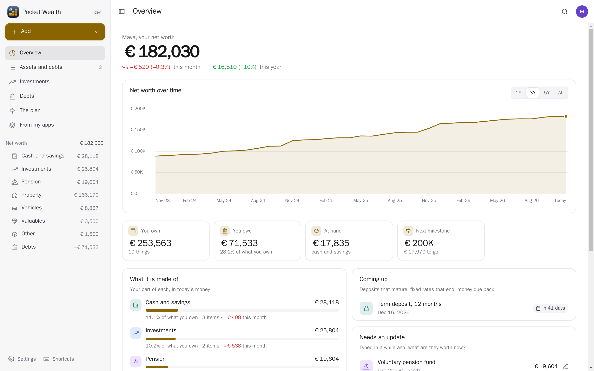
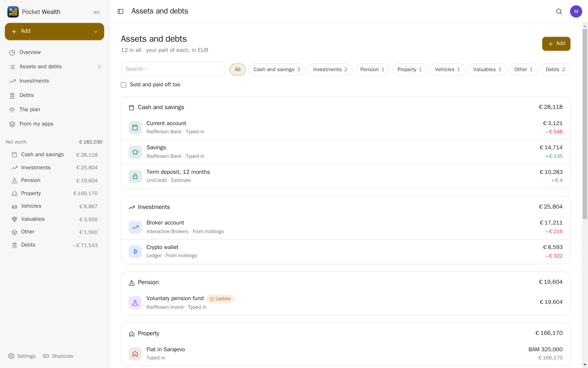
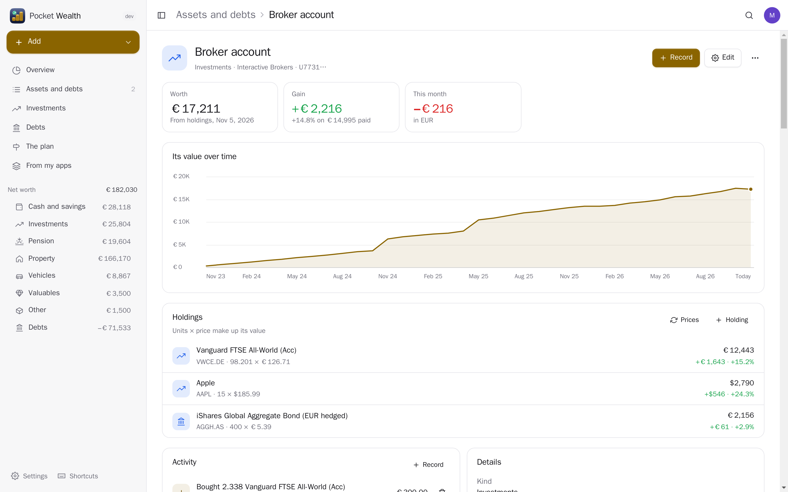
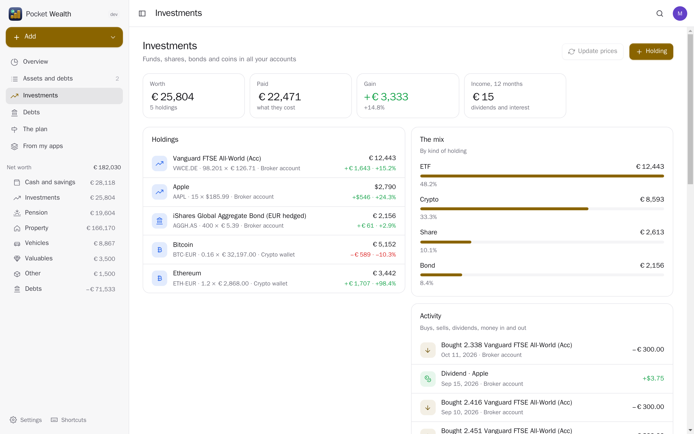
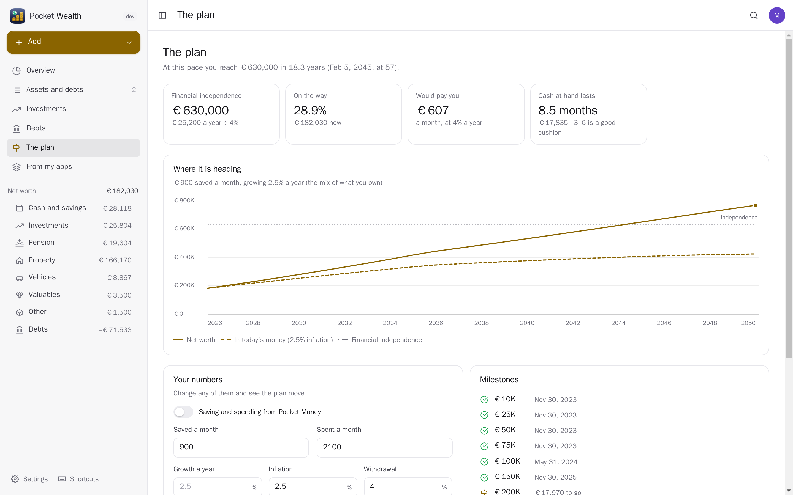
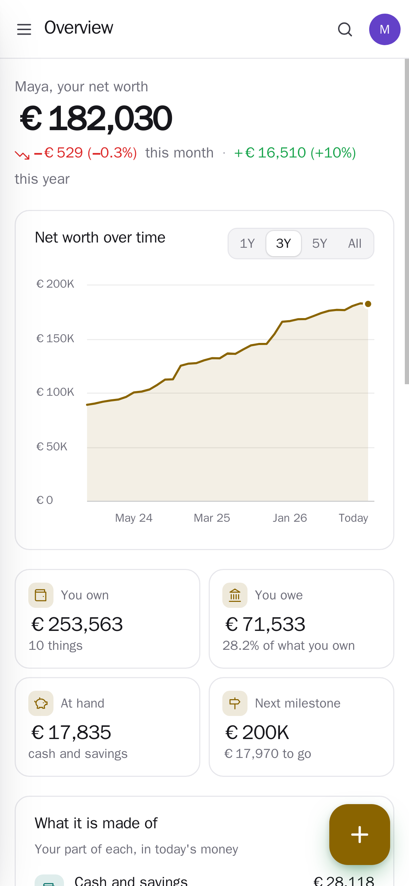
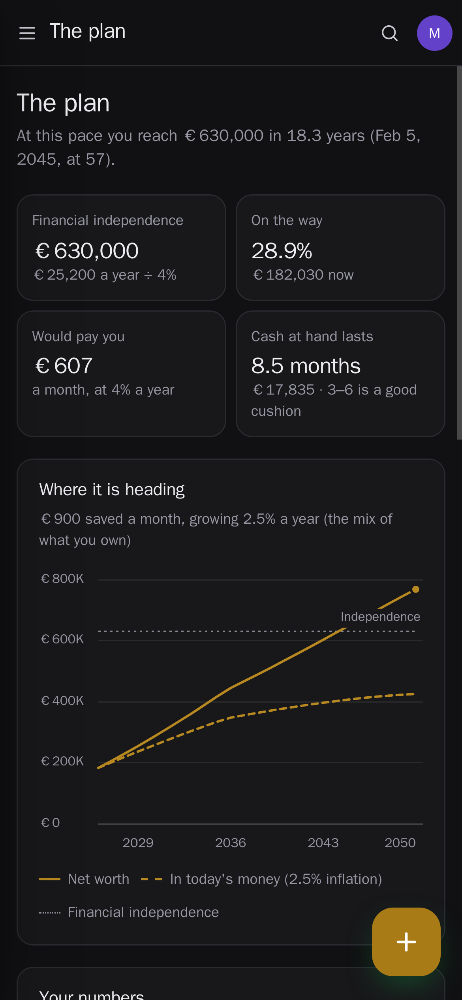

<p align="center"></p>
<h1 align="center">Pocket Wealth</h1>
<p align="center">Everything you own and owe, in one number: bank accounts and savings, investments with live prices, your pension, the flat, the car and the valuables, minus the mortgage, loans and cards. See how your net worth moves month by month, what each investment gained, when each debt is paid off, and when you could live from what you own. It brings in what your other Pocket apps already know: Money accounts and loans, Garage vehicles, Home homes, Inventory valuables.<br>One Go binary, one SQLite file, one volume. Part of the Pocket apps; works on its own too.</p>
<p align="center">
  <a href="https://github.com/abjelosevic88/pocket-homelab-wealth/actions"></a>
  <a href="https://github.com/abjelosevic88/pocket-homelab-wealth/pkgs/container/pocket-homelab-wealth"></a>
  <a href="LICENSE"></a>
</p>

---

<p align="center"></p>

| | |
|---|---|
|  |  |
|  |  |
|  |  |

## What it does

- **Net worth, now and over time**: what you own minus what you owe, the change this month and this year, a chart from the first value you typed in, and what it is made of (cash, investments, pension, property, vehicles, valuables, debts). Every value is kept, so a value you backfill fixes the history by itself.
- **Each thing its own way**: a value you type in from a statement now and then; **holdings** (units × price of each fund, share or coin, prices looked up on Yahoo Finance); an **estimate** that grows or shrinks by a percentage a year (a car loses 15%, a term deposit earns its rate); or **linked** to the Pocket app it lives in. Your share of a shared flat, any currency (exchange rates from the European Central Bank, or your own).
- **Investments**: every holding with its cost and gain, the mix, buys and sells that update the units and cost, dividends and interest as income from what you own.
- **Debts**: what is owed, the interest this month, when each is paid off, and what paying a little more each month saves.
- **The plan**: at today's saving and the expected growth of what you own, net worth year by year (and in today's money), when you reach financial independence (yearly spending ÷ 4%) or your own target, how many months the cash at hand lasts, and the milestones passed.
- **Reminders**: on the 1st, how last month went and what moved most; the values that need an update; milestones (100k, 250k…); a deposit maturing or a fixed rate ending in 30 days.
- **Statements**: keep a statement or loan contract with an asset (from Pocket Documents or a link) and let AI read the balance off it; you confirm before anything is saved.
- Per person: everyone has their own assets and connections; admins do not see anyone else's. Light and dark, phone first, a JSON export/import and every value as CSV.

## Run it

```sh
docker run -d --name pocket-wealth -p 8080:8080 -v ./data:/data \
  -e BASE_URL=https://wealth.example.com -e SECURE_COOKIES=true \
  ghcr.io/abjelosevic88/pocket-homelab-wealth:latest
```

or `docker compose up -d` with [docker-compose.yml](docker-compose.yml). Open it, create the first account and add what you own, or connect your apps. All options: [docs/configuration.md](docs/configuration.md). API: [docs/api.md](docs/api.md). Backups: [docs/backup.md](docs/backup.md).

Try it with example data: `make run` (or `DEMO_DATA=true AUTH_MODE=none ./pocket-wealth`).

## With Pocket Core

Set `CORE_URL` and `CORE_REGISTRATION_KEY` and Wealth joins the box: people sign in with Pocket Core, and through app links each person's own Pocket apps feed it with nothing to paste:

| App | What for | Scopes |
|---|---|---|
| Pocket Money | accounts, cards and loans with their balances, read as they change; income and spending for the plan and the emergency fund | `accounts:read`, `transactions:read`, `events:read` |
| Pocket Garage | vehicles at an estimated value from their price and age, closed when sold | `vehicles:read` |
| Pocket Home | homes as property, with a link back to their upkeep | `home:read` |
| Pocket Inventory | valuables at what they cost | `items:read`, `events:read` |
| Pocket Documents | statements and contracts kept with an asset, a balance read by AI | `documents:read` |

Other apps can read your net worth (`wealth:read`: Pocket AI, Pocket Day's journal, Pocket Renewals for deposits that mature and fixed rates that end) or add values, buys and dividends (`wealth:write`). Events on the bus: `wealth.asset_saved`, `wealth.valuation_added`, `wealth.activity_added`, `wealth.milestone_reached`, `wealth.monthly`, `wealth.matures_soon`. Without Core every connection can be made directly with a URL and a token; the Core-only choices stay visible, greyed out.

## Build

Go 1.26 and Node 22. `make` builds the web UI and the binary, `make test` runs vet, the Go tests and the TypeScript check, `make run` starts it with example data. Releases for Linux (amd64, arm64, armv7), macOS, Windows and FreeBSD, and a multi-arch image on ghcr.io.

The plan is a rough guide, not financial advice.

## License

MIT © 2026 Aleksandar Bjelosevic
